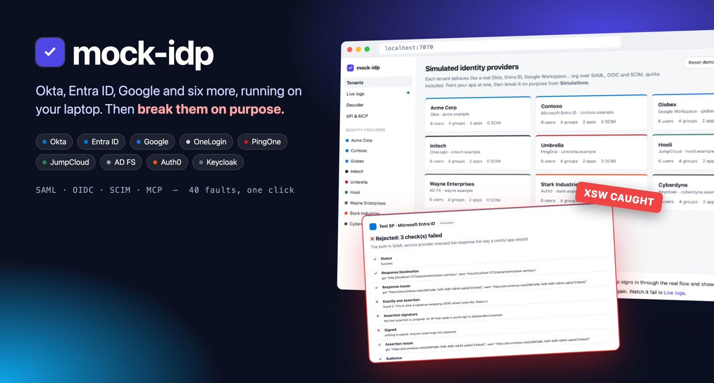
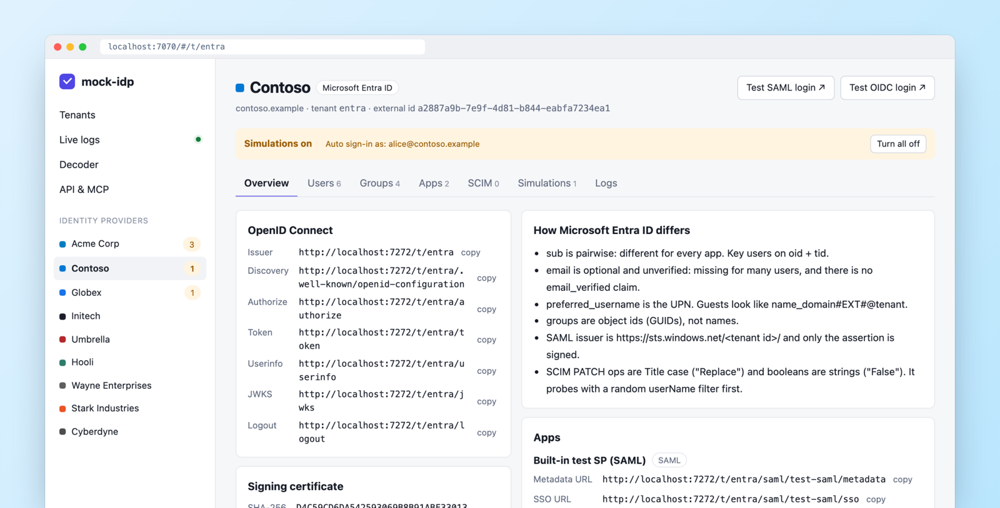
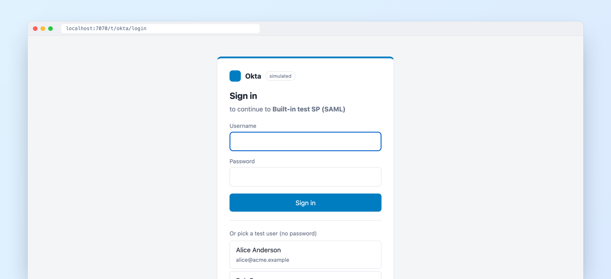
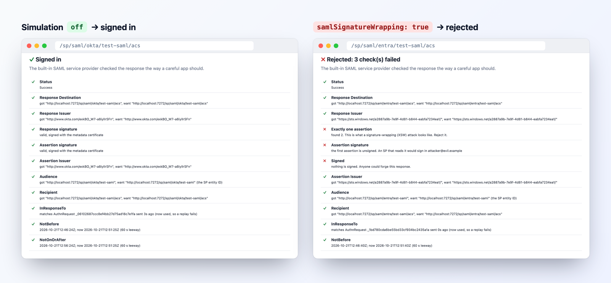
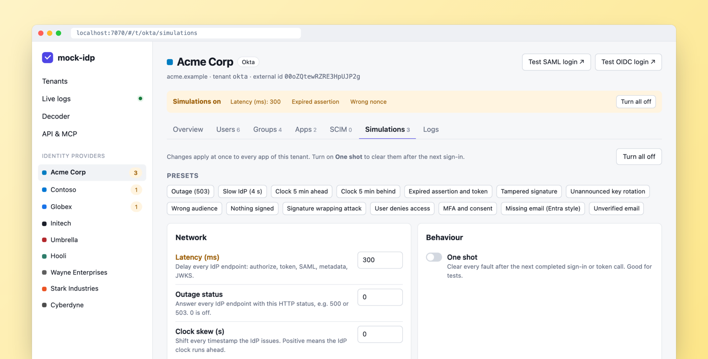
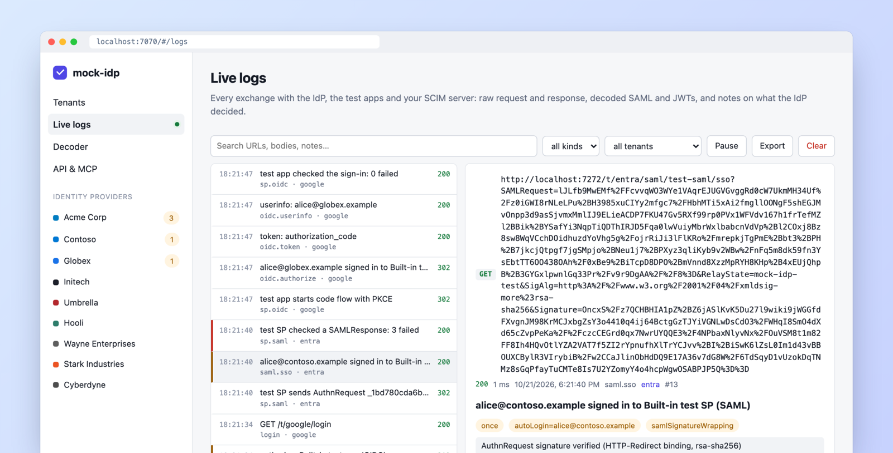
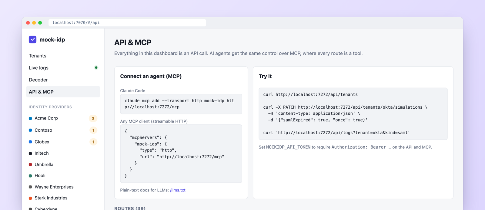
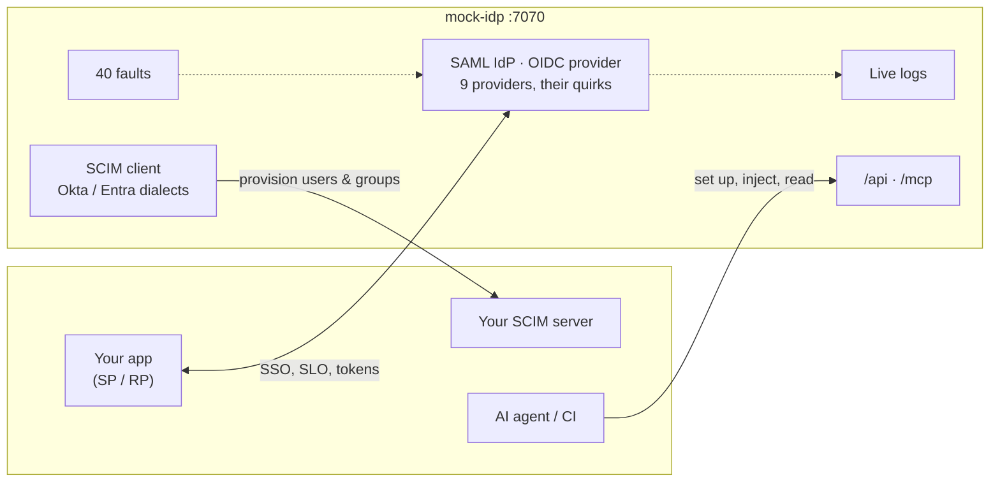

<p align="center">
  
</p>

<p align="center">
  <a href="https://github.com/ssojet/mock-idp/actions/workflows/ci.yml"></a>
  <a href="https://github.com/ssojet/mock-idp/pkgs/container/mock-idp"></a>
  
  
  
</p>

<p align="center">
  <b>Okta, Entra ID, Google Workspace and six more identity providers, on your laptop.</b><br>
  Test SAML, OIDC and SCIM without begging anyone for a test tenant. Then break them on purpose.
</p>

<p align="center">
  <a href="#-start-in-10-seconds">Quick start</a> ·
  <a href="#-a-60-second-tour">Tour</a> ·
  <a href="#-the-fault-catalogue">40 faults</a> ·
  <a href="#-use-it-in-tests">In your tests</a> ·
  <a href="#-let-an-ai-agent-drive">AI agents</a> ·
  <a href="#-library-report-card">Library report card</a>
</p>

---

## ⚡ Start in 10 seconds

```bash
docker run -p 7070:7070 ghcr.io/ssojet/mock-idp
```

Open **http://localhost:7070**. Nine demo companies are already there, each with users, groups and two test apps.

> [!TIP]
> Press **Test SAML login** on any tenant. A built-in service provider signs in through the real flow and shows every check it ran. You don't need your own app to see how it works.

## 🤔 Why this exists

| You want to test… | The real way | With mock-idp |
|---|---|---|
| SSO with Okta | Sign up for a dev org, click through the admin UI | `docker run`, one second |
| Entra ID's odd claims | Ask IT for an app registration, wait | Already there: pairwise `sub`, no `email`, `#EXT#` guests |
| An expired assertion | Wait, or fake the clock | One toggle |
| A signature-wrapping attack | Write the forgery yourself | One toggle |
| Okta pushing SCIM to your app | Okta tenant, public URL, tunnel | Point it at `localhost` |
| All of it in CI | Shared test tenants that break | One container per job |

## 🎬 A 60-second tour

### 1. Every provider behaves like the real one

Each tenant shows its endpoints, its signing certificate, and a plain list of how that provider differs from the spec.



### 2. Sign in for real

A branded login page with test users built for edge cases: a deactivated user, an unverified email, a guest, and a name with non-ASCII characters.



### 3. Break it on purpose

Flip a fault on, sign in again, and see it land. Same login, one toggle:



Turn on single faults or a preset ("Clock 5 min ahead", "Unannounced key rotation", "Missing email (Entra style)"). **One shot** clears them after the next sign-in, which is what you want in tests.



### 4. See exactly what happened

Every request and response streams into the live log. SAML and JWTs are decoded, and the IdP notes what it decided and why.



### 5. Hand it to an agent

Everything the dashboard does is a JSON API call, and every call is also an MCP tool.



## 🧩 What's inside



- **9 providers, with their quirks.** Okta, Microsoft Entra ID, Google Workspace, OneLogin, PingOne, JumpCloud, AD FS, Auth0, Keycloak, plus a plain generic one. Each has its own id format, issuer format, claim shapes, SAML attribute names and SCIM dialect.
- **SAML 2.0 IdP.** Metadata, SP- and IdP-initiated SSO (Redirect and POST bindings), SLO, signed response and/or assertion.
- **Encrypted assertions.** AES-128/256 in CBC or GCM, RSA-OAEP or RSA 1.5 key transport, signed then encrypted. Paste the SP's certificate or its whole metadata.
- **Signed AuthnRequests.** Verified in both bindings against the SP's signing certificate. Optionally required, and advertised in the metadata.
- **OIDC provider.** Discovery, JWKS, authorization code + PKCE, implicit, refresh tokens, client credentials, password grant, userinfo, logout.
- **SCIM client.** Provisions users and groups into *your* app as Okta or Entra would. Auto-push on change, full sync, and a conformance suite.
- **Built-in test SP and RP.** A careful app that signs in through the real flow and shows every check.
- **Live logs, API, MCP.** See below.

<details>
<summary><b>Provider quirks, one line each</b></summary>

| Provider | What catches people out |
|---|---|
| **Okta** | `sub` is the Okta id (`00u…`), not the email. SAML issuer is different for every app. SCIM updates are a PUT of the whole user, and deprovisioning only sets `active=false`. |
| **Entra ID** | `sub` is pairwise per app; key users on `oid` + `tid`. `email` is often missing. Groups are GUIDs. Only the assertion is signed. SCIM PATCH ops are Title case and booleans are strings (`"False"`). |
| **Google Workspace** | `sub` is a 21-digit number. Check `hd` if only one company may sign in. SAML sends no attributes until an admin maps them. |
| **OneLogin** | Attributes are `User.email`, `User.FirstName`. User ids are numbers. |
| **PingOne** | Issuer is `https://auth.pingone.com/<environment id>`. |
| **JumpCloud** | Issuer is whatever the admin typed. Deprovisioning DELETEs the user. |
| **AD FS** | Claims are long `schemas.xmlsoap.org` URIs. NameID comes from the username. |
| **Auth0** | `sub` is `connection\|id`, like `auth0\|64f…`. |
| **Keycloak** | Groups are paths like `/Engineering`. Issuer is `<base>/realms/<realm>`. |

</details>

## 💥 The fault catalogue

40 switches. Each one is a toggle in the dashboard and a field in one API call.

<details open>
<summary><b>SAML (17)</b></summary>

| Key | What your app should do |
|---|---|
| `samlUnsigned` | Reject: nothing is signed |
| `samlBadSignature` | Reject: tampered after signing |
| `samlWrongCert` | Reject: signed by an unknown key |
| `samlSha1` | Reject (or warn): SHA-1 signature |
| `samlSignatureWrapping` | Reject: XSW, a forged unsigned assertion comes first |
| `samlCommentInjection` | Read the full NameID, not the text before a comment |
| `samlWrongIssuer` · `samlWrongAudience` · `samlWrongDestination` · `samlWrongRecipient` · `samlWrongInResponseTo` | Reject: wrong value |
| `samlExpired` · `samlNotYetValid` | Reject: outside the time window |
| `samlMissingNameId` · `samlNoAttributes` | Fail with a clear error, don't crash |
| `samlNotEncrypted` · `samlWrongEncryptionKey` | Reject a plaintext assertion when you asked for encryption; fail cleanly on a bad key |

</details>

<details>
<summary><b>OIDC (12)</b></summary>

| Key | What your app should do |
|---|---|
| `oidcExpired` | Reject the expired ID token |
| `oidcWrongIssuer` · `oidcWrongAudience` | Reject |
| `oidcBadSignature` · `oidcAlgNone` · `oidcUnknownKid` | Reject. For `kid`, refetch the JWKS once first |
| `oidcWrongNonce` · `oidcWrongAtHash` · `oidcWrongState` | Reject: replay or mix-up |
| `oidcMissingEmail` · `oidcEmailUnverified` | Don't trust or link on an email you can't rely on |
| `tokenError` | Show the error from the token endpoint |

</details>

<details>
<summary><b>Login flow, network and behaviour (11)</b></summary>

| Key | What it does |
|---|---|
| `autoLogin` | Skip the login page and sign in as this user. Best for automated tests |
| `once` | Clear every fault after the next completed sign-in |
| `requireMfa` · `showConsent` | Add an MFA step or an OIDC consent screen |
| `lockedOut` · `authError` | Refuse the sign-in |
| `anyPassword` | Accept any password |
| `pauseBeforeSend` | Show the decoded response before it goes to the app, and wait for a click |
| `latencyMs` | Slow down every IdP endpoint |
| `httpStatus` | Answer every IdP endpoint with this status, e.g. 503 |
| `clockSkewSec` | Shift every timestamp the IdP issues |

</details>

## 🧪 Use it in tests

Skip the login page and break **only the next** sign-in:

```bash
curl -X PATCH localhost:7070/api/tenants/okta/simulations \
  -H 'content-type: application/json' \
  -d '{"autoLogin": "alice@acme.example", "samlExpired": true, "once": true}'
```

Get tokens without a browser:

```bash
curl -X POST localhost:7070/api/tenants/entra/apps/test-oidc/tokens -d '{"user":"alice@contoso.example"}'
```

Get a signed SAMLResponse without a browser:

```bash
curl -X POST localhost:7070/api/tenants/okta/apps/test-saml/saml-response -d '{"user":"alice@acme.example"}'
```

Register your SCIM server, then run the conformance suite against it as Entra:

```bash
curl -X POST localhost:7070/api/tenants/entra/scim-targets -d '{"name":"app","baseUrl":"http://host.docker.internal:3000/scim/v2","token":"secret"}'
```

```bash
curl -X POST localhost:7070/api/tenants/entra/scim-targets/app/conformance -d '{"flavor":"entra"}'
```

<details>
<summary><b>docker compose</b></summary>

```yaml
services:
  mock-idp:
    image: ghcr.io/ssojet/mock-idp
    ports: ["7070:7070"]
    environment:
      MOCKIDP_BASE_URL: http://localhost:7070   # the URL the browser uses
```

Inside the compose network, `mock-idp` is allowed as a host name for the API, so your test runner can call `http://mock-idp:7070/api`.

</details>

## 🤖 Let an AI agent drive

```bash
claude mcp add --transport http mock-idp http://localhost:7070/mcp
```

Then ask: *"Make an Entra tenant, turn on signature wrapping for one sign-in, run the test SAML login, and tell me what the SP caught."*

Plain-text docs for LLMs: http://localhost:7070/llms.txt

## 📋 Library report card

`interop/run.sh` runs real client libraries against all 9 providers and every fault, and prints what each library catches.

| Library | What it covers |
|---|---|
| `@node-saml/node-saml` 5.1 (passport-saml's engine) | SP-initiated SAML, attributes, encryption, signed requests, 15 faults |
| `crewjam/saml` 0.5 | SP-initiated SAML, encryption, signed requests, 17 faults |
| `openid-client` 6.8 | code + PKCE, public clients, userinfo, refresh rotation, the real login page, SSO session, MFA, 15 faults |
| `coreos/go-oidc` 3.21 + `x/oauth2` | code + PKCE, userinfo, refresh, 15 faults |
| `@modelcontextprotocol/sdk` 1.32 | MCP connect, tools, errors |

> [!WARNING]
> **What we found.** Your library may not protect you:
> - `openid-client` does not verify the ID token signature by default. A tampered token or an unknown `kid` passes. Call `enableNonRepudiationChecks()`.
> - `node-saml` checks `idpIssuer` only on logout messages, never on the login response.
> - No library tested rejects SHA-1 signatures, a missing NameID, or a missing email claim. Your app has to.
> - `openid-client` refetches the JWKS on an unknown `kid` at most once a minute. For up to 60 s after a key rotation, a long-lived client fails. `go-oidc` refetches at once.
> - `node-saml` cannot check `InResponseTo` on a logout reply sent by POST. Use the Redirect binding.
> - `crewjam/saml` 0.5 cannot decrypt AES-256-GCM. `node-saml` decrypts all eight cipher and key-transport combinations.

<details>
<summary><b>Edge cases and platform checks</b></summary>

Also covered: IdP-initiated SSO, POST-binding requests, single logout in both bindings, RelayState, ForceAuthn, the IdP session and `prompt=none`, `form_post`, implicit flow, `client_secret_post`, client credentials, logout redirects, single-use codes, PKCE mismatch, key rotation, non-ASCII and guest names, parallel sign-ins across tenants, and latency.

`interop/platform.sh` checks the Docker image: the race detector, API-token mode, state surviving restarts, and hostile input (bad JSON, 2 MB bodies, path traversal, XML bombs, malformed SAML).

Run against a running container:

```bash
MOCKIDP_URL=http://localhost:7070 interop/run.sh
```

</details>

## ⚙️ Configuration

| Env | Flag | Default | |
|---|---|---|---|
| `MOCKIDP_ADDR` | `-addr` | `:7070` | listen address |
| `MOCKIDP_BASE_URL` | `-base-url` | `http://localhost:<port>` | URL browsers use; it goes into issuers and redirects |
| `MOCKIDP_DATA` | `-data` | `mockidp-data.json` | state file; empty keeps state in memory |
| `MOCKIDP_API_TOKEN` | | | require `Authorization: Bearer …` on the API and MCP |
| `MOCKIDP_ALLOWED_HOSTS` | | | extra dotted host names allowed to reach the API, e.g. `mockidp.dev.internal` |

> [!NOTE]
> The API and MCP refuse requests from other web pages and from unknown dotted host names, so a site you visit cannot drive your local mock-idp (cross-site requests, DNS rebinding). `localhost`, IP addresses, single-label names like a compose service (`mock-idp`) and `host.docker.internal` always work. The IdP endpoints under `/t/` are open to any host.

Seeded apps store absolute URLs. After changing `MOCKIDP_BASE_URL`, run `POST /api/reset`.

## 🛠️ Develop

```bash
go run .
```

```bash
go test ./...
```

One Go binary, two dependencies (`beevik/etree`, `russellhaering/goxmldsig`), and a no-build dashboard in `web/`.

## 🗺️ Not yet

Inbound SCIM (the IdP as a SCIM server) and WS-Fed. Open an issue if you need one.

> [!CAUTION]
> This is a test tool. Never point production at it.

---

<p align="center">
  Built by <a href="https://ssojet.com/?utm_source=github&utm_medium=mock-idp"><b>SSOJet</b></a>.<br>
  Tests pass? SSOJet runs enterprise SSO and SCIM for real.
</p>
